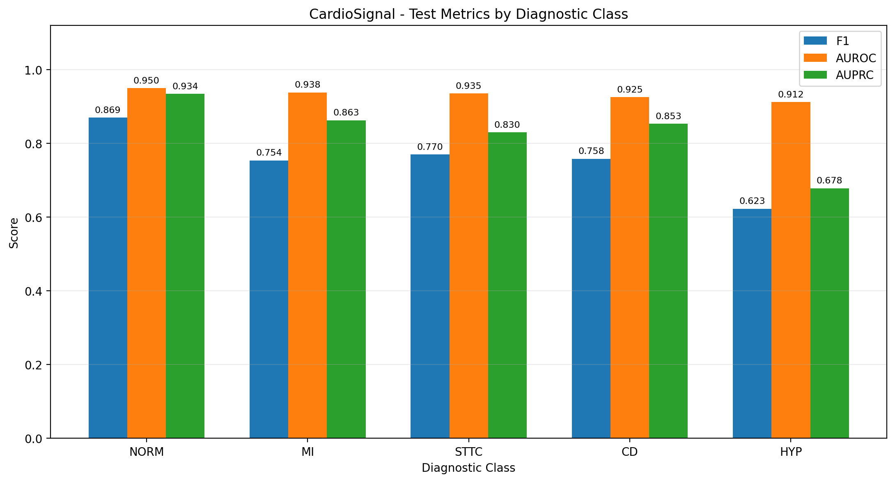
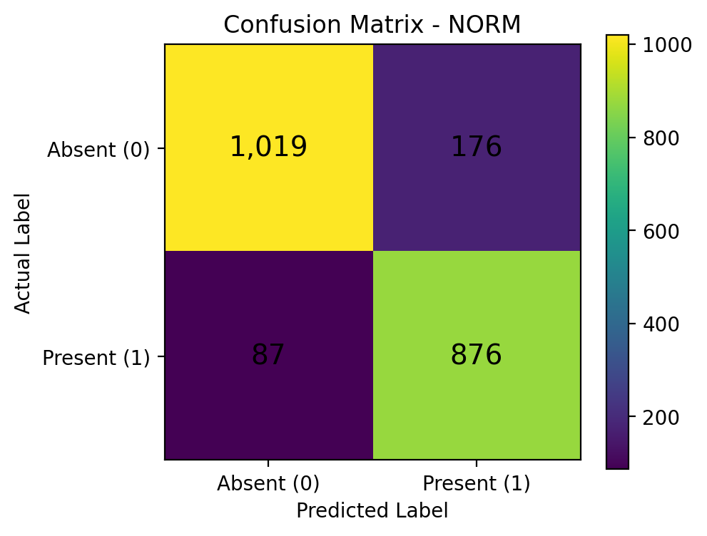
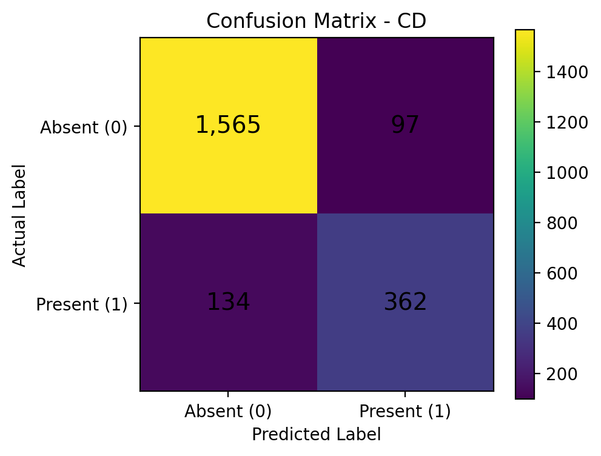
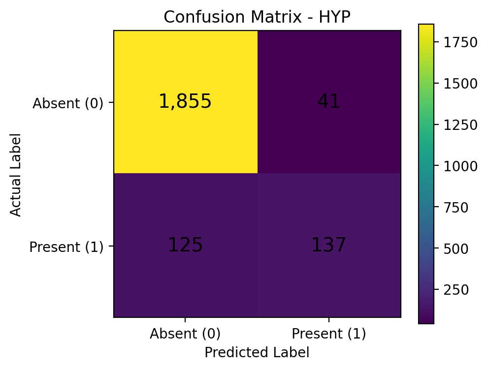

# CardioSignal

**An end-to-end deep learning project for multi-label classification of 12-lead ECG signals.**

CardioSignal is a research and engineering project built around the PTB-XL electrocardiography dataset. It provides a configurable data pipeline, 1D convolutional neural network architectures, training and evaluation utilities, and experiment tracking with MLflow.

> **Research-use disclaimer:** CardioSignal is an educational and experimental machine-learning project. It is not a medical device, has not been clinically validated, and must not be used to diagnose, treat, or make decisions about a patient's health.

## Project goals

- Build a reproducible ECG classification pipeline using PyTorch.
- Work with the official patient-wise PTB-XL folds.
- Compare 1D CNN and 1D ResNet architectures.
- Evaluate multi-label predictions with class-wise and aggregate metrics.
- Track training experiments with MLflow.
- Keep datasets, checkpoints, and generated artifacts out of Git.

## Dataset

This project uses **PTB-XL v1.0.3**, a publicly available dataset containing 10-second, 12-lead ECG recordings. The configured pipeline uses the 500 Hz recordings (`records500`), giving 5,000 samples per lead.

- Dataset: [PTB-XL v1.0.3 on PhysioNet](https://physionet.org/content/ptb-xl/1.0.3/)
- Version DOI: [10.13026/kfzx-aw45](https://doi.org/10.13026/kfzx-aw45)
- Dataset license: Creative Commons Attribution 4.0 International (CC BY 4.0)

### Target labels

The task is configured as **multi-label classification** with five diagnostic superclasses:

| Label | Description |
|---|---|
| `NORM` | Normal ECG |
| `MI` | Myocardial infarction |
| `STTC` | ST/T change |
| `CD` | Conduction disturbance |
| `HYP` | Hypertrophy |

A recording may have more than one positive label. The project maps the PTB-XL SCP-ECG statements to these configured superclasses.

### Input representation

| Property | Configuration |
|---|---:|
| Leads | 12 |
| Sampling frequency | 500 Hz |
| Recording duration | 10 seconds |
| Samples per lead | 5,000 |
| Model input shape | `(batch, 12, 5000)` |
| Task | Multi-label classification |

### Official patient-wise folds

The project follows the recommended PTB-XL fold assignment:

| Split | Folds |
|---|---|
| Train | 1–8 |
| Validation | 9 |
| Test | 10 |

The folds keep records from the same patient within one fold. After excluding records without usable labels, the local data preparation currently reports:

| Split | Records |
|---|---:|
| Train | 17,084 |
| Validation | 2,146 |
| Test | 2,158 |
| **Total** | **21,388** |

These counts describe the current preprocessing and label-selection setup; they are not model-performance results.

## Project structure

```text
cardiosignal/
├── configs/
│   ├── data.yaml
│   ├── model.yaml
│   └── training.yaml
├── scripts/
│   ├── inspect_dataset.py
│   ├── prepare_data.py
│   ├── test_dataloaders.py
│   └── test_real_dataset.py
├── src/
│   └── cardiosignal/
│       ├── api/
│       ├── data/
│       ├── inference/
│       ├── models/
│       └── training/
├── tests/
├── pyproject.toml
├── README.md
└── MODEL_CARD.md
```

Raw dataset files, local checkpoints, normalization statistics, MLflow databases, and experiment outputs are generated or downloaded locally and are intentionally excluded from version control.

## Models

Two 1D architectures are implemented:

- **CNN1D** — a configurable 1D convolutional network.
- **ResNet1D** — a residual 1D network with configurable stage widths and residual blocks.

The current model configuration uses ResNet1D by default. Both models produce raw logits. Sigmoid probabilities are used for multi-label inference; training uses `BCEWithLogitsLoss`.

## Preprocessing

The data configuration specifies:

1. Loading 12-lead, 500 Hz waveforms from PTB-XL.
2. Mapping SCP-ECG statements to the five configured labels.
3. Excluding records without usable target labels.
4. Splitting data by the official patient-wise folds.
5. Applying per-lead z-score normalization using statistics computed from the training split only.
6. Rejecting non-finite signal values.

Normalization statistics are written to `artifacts/normalization_stats.json`. This file is generated locally and is not committed to Git; regenerate it when preparing a fresh environment.

## Requirements

- Python `>=3.11,<3.14`
- PyTorch compatible with your Python version and hardware (CPU, CUDA, or other supported accelerator)
- Dependencies listed in `pyproject.toml`

**PyTorch installation note:** PyTorch is declared as a project dependency in `pyproject.toml`. For GPU acceleration, make sure to use a PyTorch build compatible with your CUDA environment. Verify GPU availability with `torch.cuda.is_available()`.

## Setup

The following commands use PowerShell on Windows. Run them from the repository root.

```powershell
# Create and activate a virtual environment
py -3.13 -m venv .venv
.\.venv\Scripts\Activate.ps1

# Upgrade packaging tools
python -m pip install --upgrade pip

# Install a compatible PyTorch build first (see the PyTorch installation selector)

# Install CardioSignal and development dependencies
python -m pip install -e ".[dev]"
```

If PowerShell blocks activation, see Microsoft's documentation for the execution policy applicable to your environment rather than changing system-wide security settings unnecessarily.

## Prepare the dataset

1. Download **PTB-XL v1.0.3** from [PhysioNet](https://physionet.org/content/ptb-xl/1.0.3/).
2. Extract the dataset into the repository root so that the following paths exist:

```text
ptb-xl-1.0.3/
├── ptbxl_database.csv
├── scp_statements.csv
├── records500/
└── records100/
```

3. Confirm that `configs/data.yaml` points to `ptb-xl-1.0.3` and uses `records500`.
4. Generate the preprocessing statistics and prepare the local dataset:

```powershell
python scripts/prepare_data.py
```

The raw dataset is not included in this repository. Follow the dataset's license and citation requirements when using it.

## Training

The default training configuration is defined in `configs/training.yaml`:

- 50 epochs
- Batch size 32
- AdamW optimizer
- Learning rate `0.001`
- Weight decay `0.0001`
- `BCEWithLogitsLoss`
- `ReduceLROnPlateau` scheduler
- Early stopping monitored using validation macro F1
- Best-checkpoint saving
- MLflow experiment tracking

Example full training command:

```powershell
python -m cardiosignal.training.train --model resnet1d --epochs 50 --batch-size 32
```

A short smoke test can be used to verify that the training loop runs without starting a full experiment:

```powershell
python -m cardiosignal.training.train --model cnn1d --epochs 1 --batch-size 4 --max-batches 2 --no-mlflow
```

A smoke test checks execution and data flow only. It must not be presented as a meaningful benchmark or as evidence of clinical performance.

## Evaluation

Evaluate a saved checkpoint using the evaluation module. Replace the checkpoint path with the file generated by your training run:

```powershell
python -m cardiosignal.training.evaluate --checkpoint artifacts/checkpoints/<checkpoint-name>.pt --split test --batch-size 32
```

The evaluation pipeline reports multi-label metrics including:

- Macro F1 and micro F1
- Per-class F1
- Macro AUROC
- Macro AUPRC

The configured default classification threshold is `0.5`. For a rigorous final evaluation, keep the test split untouched during model selection and threshold tuning; use validation data for those decisions.


## Model Results

A ResNet1D model was trained and evaluated using PTB-XL v1.0.3.

### Training Summary

| Configuration | Value |
|---|---|
| Architecture | ResNet1D |
| Maximum epochs | 50 |
| Completed epochs | 32 |
| Best checkpoint epoch | 22 |
| Best validation macro F1 | 0.74779 |
| Batch size | 32 |
| Optimizer | AdamW |
| Loss | BCEWithLogitsLoss |
| Early stopping patience | 10 |

### Test Set Performance

The best checkpoint was evaluated on the held-out test set containing 2,158 ECG recordings.

| Metric | Score |
|---|---:|
| Macro F1 | 0.75474 |
| Micro F1 | 0.78962 |
| Macro AUROC | 0.93206 |
| Macro AUPRC | 0.83157 |
| Test Loss | 0.26717 |

Classification threshold: `0.5`.

### Per-Class Performance

| Class | F1 | AUROC | AUPRC |
|---|---:|---:|---:|
| NORM | 0.8695 | 0.9498 | 0.9339 |
| MI | 0.7537 | 0.9381 | 0.8626 |
| STTC | 0.7697 | 0.9351 | 0.8299 |
| CD | 0.7581 | 0.9254 | 0.8533 |
| HYP | 0.6227 | 0.9120 | 0.6782 |

### Test Metrics Visualization



### Per-Class Confusion Matrices

**NORM**



**MI**


**STTC**


**CD**



**HYP**



### Evaluation Notes

- NORM achieved the highest F1 score.
- HYP was the most challenging class, with an F1 score of 0.6227.
- Results represent experimental performance on the PTB-XL benchmark and do not constitute clinical validation.

## Experiment tracking

Training configuration enables MLflow tracking with a local SQLite backend:

```text
sqlite:///mlflow.db
```

The configured experiment name is `cardiosignal-ptbxl`. The MLflow database and generated run artifacts are local experiment outputs and are not committed to Git.

## Testing

Run the automated test suite from the repository root:

```powershell
pytest -q
```

The current verified test suite contains 49 passing tests. Re-run the tests after changing data processing, models, metrics, or training code.

## Reproducibility

- Random seed: `42`
- Official patient-wise PTB-XL folds
- Training-split-only normalization statistics
- YAML-based data, model, and training configuration
- MLflow experiment tracking

Exact reproducibility can still depend on the PyTorch version, hardware, accelerator kernels, and runtime environment.

## Limitations and responsible use

- This project is an experimental implementation, not a clinically validated diagnostic system.
- The current task covers five selected PTB-XL diagnostic superclasses, not every possible cardiac condition or ECG finding.
- Performance on PTB-XL does not establish performance on other hospitals, devices, populations, or recording protocols.
- No clinical claims should be made from smoke-test metrics or from a single dataset evaluation.
- A qualified healthcare professional must interpret ECGs and make clinical decisions.

## Dataset citation

If you use PTB-XL, cite the dataset as requested by PhysioNet:

> Wagner, P., Strodthoff, N., Bousseljot, R., Samek, W., & Schaeffter, T. (2022). *PTB-XL, a large publicly available electrocardiography dataset* (version 1.0.3). PhysioNet. https://doi.org/10.13026/kfzx-aw45

Also consider citing the original dataset paper:

> Wagner, P., et al. (2020). PTB-XL: A Large Publicly Available ECG Dataset. *Scientific Data*, 7, 154. https://doi.org/10.1038/s41597-020-0495-6

## Current project status
The data pipeline, model implementations, training workflow, evaluation pipeline, and automated tests are implemented.

A complete ResNet1D training run on PTB-XL v1.0.3 has been completed. The best checkpoint was selected at epoch 22, achieving a validation macro F1 of 0.74779.

Final evaluation on the held-out test set of 2,158 ECG recordings achieved a macro F1 of 0.75474 and a macro AUROC of 0.93206.

CNN1D versus ResNet1D benchmarking, additional reproducibility experiments, and deployment validation remain future work.

